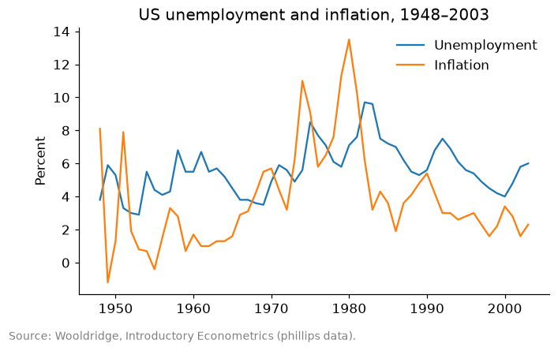
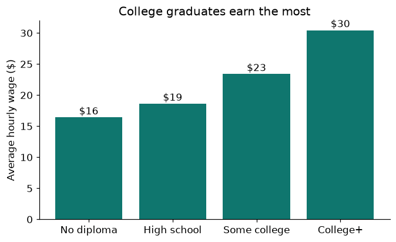
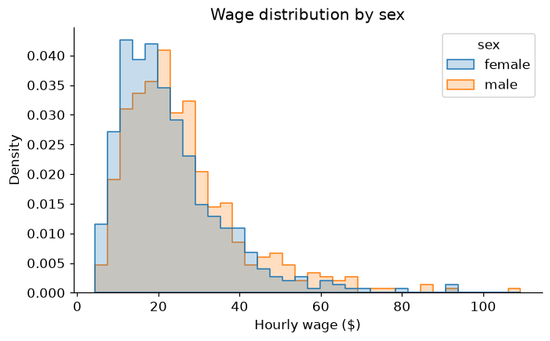
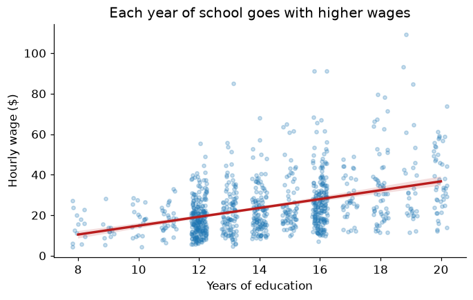
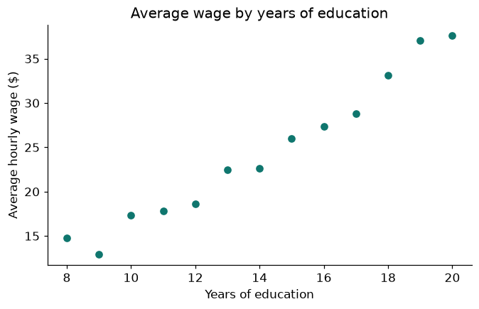
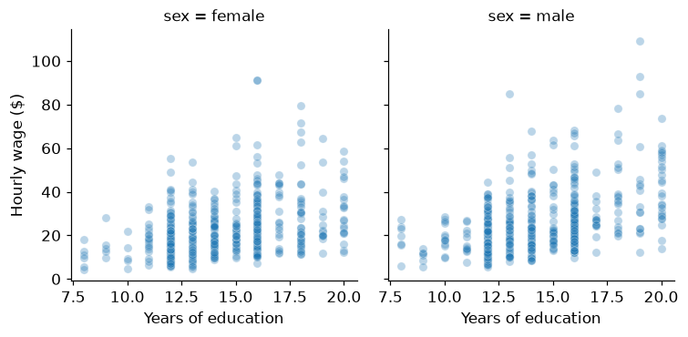

# Data visualization

A good chart makes one point clearly. In economics, charts often carry the main finding of a paper: an event study, a binned scatter plot, a time series with a policy date marked. This page covers how to choose a chart, the rules that make charts readable, and recipes for the six charts you will use most, in Stata, R and Python.

!!! info "What you will learn"
    Choosing the right chart · what makes a chart readable · six recipes: line, bar, distribution, scatter with fit, binned scatter, small multiples · consistent style · exporting for papers and slides · dashboards

    Examples use the [wages.csv](../projects/data/wages.csv) practice data and the Wooldridge `phillips` data on US inflation and unemployment.

## Choose the chart from the question

| You want to show | Use | Avoid |
|---|---|---|
| Change over time | Line chart | Bars for long time series |
| Compare amounts across groups | Bar chart (horizontal if labels are long) | Pie charts, 3-D bars |
| The spread of one variable | Histogram or density | A table of percentiles alone |
| The relationship between two variables | Scatter plot with a fitted line | Connecting the dots |
| A relationship with thousands of points | Binned scatter plot | An unreadable cloud of dots |
| The same relationship across groups | Small multiples (one panel per group) | Ten colors on one chart |
| Regression or event-study estimates | Coefficient plot with confidence intervals | A table when the pattern matters most |

## Rules for readable charts

1. **The title states the finding.** "College graduates earn the most" beats "Wages by education".
2. **Label every axis, with units.** "Hourly wage ($)", not "wage".
3. **Bars start at zero.** Lines do not have to.
4. **Remove clutter.** No 3-D effects, heavy gridlines, boxes or shadows.
5. **Label lines directly** where you can, instead of making readers match colors to a legend.
6. **Use colorblind-friendly colors.** About 1 in 12 men have color vision deficiency. Use viridis in R, `colorblind` in seaborn, or Stata's `stcolor` scheme.
7. **Cite the source** in a note under the chart.

## Set up once

Put these lines at the top of your script so every chart shares one clean style.

=== "Stata"

    ```stata
    set scheme stcolor               // Stata 18's clean default; use s2color in older versions
    graph set window fontface "Helvetica"
    ```

=== "R"

    ```r
    library(tidyverse)
    library(scales)                  # dollar and percent axis labels

    theme_set(theme_minimal(base_size = 12))
    ```

=== "Python"

    ```python
    import matplotlib.pyplot as plt
    import pandas as pd
    import seaborn as sns

    plt.rcParams.update({
        "figure.figsize": (7, 4),
        "axes.spines.top": False,
        "axes.spines.right": False,
        "font.size": 11,
    })
    ```

Load the data used in the recipes:

=== "Stata"

    ```stata
    import delimited "https://ethanbrownecon.github.io/econ-toolkit/projects/data/wages.csv", clear
    duplicates drop
    drop if missing(wage) | wage <= 0
    replace sex = lower(sex)
    recode educ (0/11 = 1 "No diploma") (12 = 2 "High school") ///
        (13/15 = 3 "Some college") (16/20 = 4 "College+"), gen(educ_group)
    ```

=== "R"

    ```r
    wages <- read_csv("https://ethanbrownecon.github.io/econ-toolkit/projects/data/wages.csv") %>%
      distinct() %>%
      filter(!is.na(wage), wage > 0) %>%
      mutate(sex = str_to_lower(sex),
             educ_group = cut(educ, breaks = c(0, 11, 12, 15, 20),
                              labels = c("No diploma", "High school", "Some college", "College+")))

    data("phillips", package = "wooldridge")
    ```

=== "Python"

    ```python
    import wooldridge

    wages = (
        pd.read_csv("https://ethanbrownecon.github.io/econ-toolkit/projects/data/wages.csv")
        .drop_duplicates()
        .dropna(subset=["wage"])
        .query("wage > 0")
    )
    wages["sex"] = wages["sex"].str.lower()
    wages["educ_group"] = pd.cut(wages["educ"], bins=[0, 11, 12, 15, 20],
                                 labels=["No diploma", "High school", "Some college", "College+"])

    phillips = wooldridge.data("phillips")
    ```

## 1. Line chart: change over time



=== "Stata"

    ```stata
    preserve
    bcuse phillips, clear nodesc
    twoway (line unem year) (line inf year), ///
        title("US unemployment and inflation, 1948–2003") ytitle("Percent") xtitle("") ///
        legend(order(1 "Unemployment" 2 "Inflation") pos(1) ring(0)) ///
        note("Source: Wooldridge, Introductory Econometrics (phillips data).")
    restore
    ```

=== "R"

    ```r
    phillips %>%
      select(year, Unemployment = unem, Inflation = inf) %>%
      pivot_longer(-year, names_to = "series", values_to = "rate") %>%
      ggplot(aes(year, rate, colour = series)) +
      geom_line(linewidth = 0.9) +
      labs(title = "US unemployment and inflation, 1948–2003",
           x = NULL, y = "Percent", colour = NULL,
           caption = "Source: Wooldridge, Introductory Econometrics (phillips data).")
    ```

    ggplot2 wants **long** data: one column for the value and one for which series it belongs to. `pivot_longer()` reshapes it.

=== "Python"

    ```python
    fig, ax = plt.subplots()
    ax.plot(phillips["year"], phillips["unem"], label="Unemployment")
    ax.plot(phillips["year"], phillips["inf"], label="Inflation")
    ax.set(title="US unemployment and inflation, 1948–2003", ylabel="Percent")
    ax.legend(frameon=False)
    fig.text(0.01, -0.02, "Source: Wooldridge, Introductory Econometrics (phillips data).",
             fontsize=9, color="gray")
    ```

!!! tip "Mark events"
    Add a vertical line at a policy date or recession: `xline(1980)` in Stata, `geom_vline(xintercept = 1980)` in R, `ax.axvline(1980)` in Python.

## 2. Bar chart: compare groups



=== "Stata"

    ```stata
    graph bar (mean) wage, over(educ_group) ///
        blabel(bar, format(%3.0f)) bar(1, color("15 118 110")) ///
        ytitle("Average hourly wage ($)") title("College graduates earn the most")
    ```

=== "R"

    ```r
    wages %>%
      summarise(wage = mean(wage), .by = educ_group) %>%
      ggplot(aes(educ_group, wage)) +
      geom_col(fill = "#0f766e") +
      geom_text(aes(label = dollar(wage, accuracy = 1)), vjust = -0.4) +
      scale_y_continuous(labels = label_dollar()) +
      labs(title = "College graduates earn the most", x = NULL, y = "Average hourly wage")
    ```

=== "Python"

    ```python
    means = wages.groupby("educ_group", observed=True)["wage"].mean()

    fig, ax = plt.subplots()
    ax.bar(means.index.astype(str), means.values, color="#0f766e")
    for i, v in enumerate(means.values):
        ax.text(i, v + 0.5, f"${v:.0f}", ha="center")
    ax.set(title="College graduates earn the most", ylabel="Average hourly wage ($)")
    ```

**Check:** average wages are about $16, $19, $23 and $30.

## 3. Distribution: histogram or density



=== "Stata"

    ```stata
    twoway (kdensity wage if sex == "female") (kdensity wage if sex == "male"), ///
        legend(order(1 "Female" 2 "Male")) xtitle("Hourly wage ($)") ///
        title("Wage distribution by sex")
    ```

    For a histogram of one group: `histogram wage, percent`.

=== "R"

    ```r
    ggplot(wages, aes(wage, fill = sex)) +
      geom_density(alpha = 0.4) +
      scale_x_continuous(labels = label_dollar()) +
      labs(title = "Wage distribution by sex", x = "Hourly wage", y = "Density", fill = NULL)
    ```

    For a histogram: `geom_histogram(bins = 30)`.

=== "Python"

    ```python
    fig, ax = plt.subplots()
    sns.histplot(data=wages, x="wage", hue="sex", element="step",
                 stat="density", common_norm=False, ax=ax)
    ax.set(title="Wage distribution by sex", xlabel="Hourly wage ($)")
    ```

`stat="density"` with `common_norm=False` scales each group separately, so groups of different sizes compare fairly.

## 4. Scatter plot with a fitted line



=== "Stata"

    ```stata
    twoway (scatter wage educ, jitter(3) mcolor(%25) msize(small)) ///
           (lfit wage educ, lcolor(cranberry)), ///
        legend(off) xtitle("Years of education") ytitle("Hourly wage ($)") ///
        title("Each year of school goes with higher wages")
    ```

=== "R"

    ```r
    ggplot(wages, aes(educ, wage)) +
      geom_jitter(width = 0.25, alpha = 0.25, size = 1) +
      geom_smooth(method = "lm", colour = "#b91c1c") +
      labs(title = "Each year of school goes with higher wages",
           x = "Years of education", y = "Hourly wage ($)")
    ```

=== "Python"

    ```python
    fig, ax = plt.subplots()
    sns.regplot(data=wages, x="educ", y="wage", x_jitter=0.25,
                scatter_kws={"alpha": 0.25, "s": 12}, line_kws={"color": "#b91c1c"}, ax=ax)
    ax.set(title="Each year of school goes with higher wages",
           xlabel="Years of education", ylabel="Hourly wage ($)")
    ```

**Jitter** adds a little random noise to x so points with the same value do not stack on top of each other. **Transparency** (`%25`, `alpha`) shows where points are dense.

## 5. Binned scatter plot

With thousands of points, a scatter plot becomes a blob. A **binned scatter plot** groups x into bins and plots the average y in each. It is one of the most common charts in applied economics papers.



=== "Stata"

    ```stata
    ssc install binscatter
    binscatter wage educ, discrete       // discrete: one bin per value of educ
    ```

    Drop `discrete` for a continuous x. `binscatter` then makes 20 equal-sized bins. Add `controls(age)` to adjust for other variables.

=== "R"

    ```r
    wages %>%
      summarise(wage = mean(wage), .by = educ) %>%
      ggplot(aes(educ, wage)) +
      geom_point(colour = "#0f766e", size = 2.5) +
      labs(title = "Average wage by years of education",
           x = "Years of education", y = "Average hourly wage ($)")
    ```

    For continuous x, the [binsreg](https://nppackages.github.io/binsreg/) package picks bins and adds confidence bands.

=== "Python"

    ```python
    bins = wages.groupby("educ")["wage"].mean()

    fig, ax = plt.subplots()
    ax.scatter(bins.index, bins.values, color="#0f766e")
    ax.set(title="Average wage by years of education",
           xlabel="Years of education", ylabel="Average hourly wage ($)")
    ```

    For continuous x, cut it into bins first: `wages.groupby(pd.qcut(wages["age"], 20))["wage"].mean()`, or use the [binsreg](https://nppackages.github.io/binsreg/) package.

## 6. Small multiples

One panel per group, with the same axes, is easier to read than many colors on one chart.



=== "Stata"

    ```stata
    twoway (scatter wage educ, mcolor(%25)), by(sex, note("")) ///
        xtitle("Years of education") ytitle("Hourly wage ($)")
    ```

=== "R"

    ```r
    ggplot(wages, aes(educ, wage)) +
      geom_point(alpha = 0.3) +
      facet_wrap(~sex) +
      labs(x = "Years of education", y = "Hourly wage ($)")
    ```

=== "Python"

    ```python
    g = sns.relplot(data=wages, x="educ", y="wage", col="sex", alpha=0.3, height=3.5)
    g.set_axis_labels("Years of education", "Hourly wage ($)")
    ```

## Coefficient and event-study plots

Regression results are often clearer as a plot of estimates with confidence intervals. The [difference-in-differences page](../econometrics/did.md#part-2-many-periods-and-event-studies) shows event-study plots: `csdid_plot` in Stata, `iplot()` or `ggdid()` in R, and `.iplot()` in Python. For any regression, try `coefplot` in Stata (`ssc install coefplot`), `modelplot()` from modelsummary in R, or `pf.coefplot()` in Python.

## Export for papers and slides

| Destination | Format | Code |
|---|---|---|
| LaTeX paper | PDF (vector: sharp at any size) | Stata `graph export fig.pdf`, R `ggsave("fig.pdf")`, Python `fig.savefig("fig.pdf")` |
| Word, slides, web | PNG at 300 dpi | Stata `graph export fig.png, width(2000)`, R `ggsave("fig.png", dpi = 300)`, Python `fig.savefig("fig.png", dpi=300)` |

- **Set the size in code**, for example `ggsave(width = 7, height = 4)` or `figsize=(7, 4)`, so fonts stay the same size every time you rebuild the chart.
- **Save to `output/figures/`** from your script. Never copy and paste charts by hand. See the [templates](../templates/index.md).
- In LaTeX, include the chart with `\includegraphics[width=\linewidth]{output/figures/fig.pdf}`. See the [LaTeX guide](../latex/README.md#figures).

## Dashboards: Power BI and Tableau

For interactive dashboards that others click through, analysts often use **Power BI** (Microsoft, free desktop app on Windows) or **Tableau** (free for students). They connect to Excel, CSV files and databases, and you build charts by dragging fields. They suit monitoring and business reporting. For research, a chart made in code is better because you can reproduce it exactly.

- [Power BI learning paths](https://learn.microsoft.com/en-us/training/powerplatform/power-bi)
- [Tableau for Students](https://www.tableau.com/academic/students)

## Learn more

- [Fundamentals of Data Visualization](https://clauswilke.com/dataviz/) by Claus Wilke: which chart to use and why
- [Data Visualization: A Practical Introduction](https://socviz.co/) by Kieran Healy: ggplot2 for social scientists
- [The R Graph Gallery](https://r-graph-gallery.com/) and [The Python Graph Gallery](https://python-graph-gallery.com/): hundreds of examples with code
