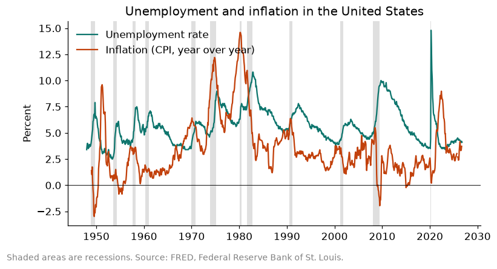

# Project 2: The economy in charts

Download 75 years of US economic data from FRED, the Federal Reserve's free database, and test two famous ideas from your macroeconomics course: the **Phillips curve** (a trade-off between inflation and unemployment) and **Okun's law** (faster growth means lower unemployment).

!!! info "What you will practice"
    Downloading data from the web · merging time series · year-over-year growth rates · converting monthly data to quarterly · shading recessions on a chart · correlations by decade · a time-series regression

    **Time:** about an hour. **Languages:** Stata, R or Python. Pick one in any tab and the whole page follows.



## The data

Every FRED series has a short code. This project uses four:

| Code | Series | Frequency |
|---|---|---|
| [`UNRATE`](https://fred.stlouisfed.org/series/UNRATE) | Unemployment rate (%) | Monthly |
| [`CPIAUCSL`](https://fred.stlouisfed.org/series/CPIAUCSL) | Consumer Price Index | Monthly |
| [`USREC`](https://fred.stlouisfed.org/series/USREC) | Recession indicator (1 = recession) | Monthly |
| [`GDPC1`](https://fred.stlouisfed.org/series/GDPC1) | Real GDP (billions of 2017 dollars) | Quarterly |

!!! note "Your numbers will differ slightly"
    FRED adds new data every month and sometimes revises old data. The "Check" numbers on this page were computed in late 2026.

## Step 1: A function that downloads any series

FRED offers each series as a CSV file at `https://fred.stlouisfed.org/graph/fredgraph.csv?id=CODE`. The function below downloads it once into `data/raw/`, then reads the saved copy every time after that. Saving raw data is good practice: your results do not change when FRED updates, until you choose to download again.

=== "Stata"

    ```stata
    capture mkdir "data"
    capture mkdir "data/raw"

    capture program drop fred
    program define fred
        args series
        local file "data/raw/`series'.csv"
        capture confirm file "`file'"
        if _rc shell curl -sL -o "`file'" "https://fred.stlouisfed.org/graph/fredgraph.csv?id=`series'"
        import delimited "`file'", clear
        gen date = date(observation_date, "YMD")
        format date %td
        drop observation_date
    end
    ```

    FRED blocks Stata's built-in web downloader, so this uses `curl`, which is built into macOS and Windows 10 and later. Alternatively, Stata's `import fred` command works with a free [API key](../data/apis.md#apis-with-a-key-fred).

=== "R"

    ```r
    library(tidyverse)
    library(fixest)

    dir.create("data/raw", recursive = TRUE, showWarnings = FALSE)

    fred <- function(series) {
      file <- file.path("data/raw", paste0(series, ".csv"))
      if (!file.exists(file)) {
        download.file(paste0("https://fred.stlouisfed.org/graph/fredgraph.csv?id=", series),
                      file, quiet = TRUE)
      }
      read_csv(file, show_col_types = FALSE) %>% rename(date = observation_date)
    }
    ```

=== "Python"

    ```python
    import urllib.request
    from pathlib import Path

    import matplotlib.pyplot as plt
    import pandas as pd
    import pyfixest as pf

    RAW = Path("data/raw")
    RAW.mkdir(parents=True, exist_ok=True)

    def fred(series):
        file = RAW / f"{series}.csv"
        if not file.exists():
            urllib.request.urlretrieve(
                f"https://fred.stlouisfed.org/graph/fredgraph.csv?id={series}", file)
        return (pd.read_csv(file, parse_dates=["observation_date"])
                .rename(columns={"observation_date": "date"}))
    ```

## Step 2: Combine the monthly series

Merge unemployment, prices and the recession indicator by date. Then compute **inflation** as the percentage change in prices over the previous 12 months.

\[
\text{inflation}_t = \left(\frac{\text{CPI}_t}{\text{CPI}_{t-12}} - 1\right) \times 100
\]

=== "Stata"

    ```stata
    fred UNRATE
    gen month = mofd(date)
    tempfile unrate
    save `unrate'

    fred USREC
    gen month = mofd(date)
    tempfile usrec
    save `usrec'

    fred CPIAUCSL
    gen month = mofd(date)
    merge 1:1 month using `unrate', keep(match) nogenerate
    merge 1:1 month using `usrec', keep(match) nogenerate

    format month %tm
    tsset month                                           // declare monthly time series
    gen inflation = (cpiaucsl / L12.cpiaucsl - 1) * 100   // L12. = 12 months earlier
    ```

=== "R"

    ```r
    df <- fred("UNRATE") %>%
      inner_join(fred("CPIAUCSL"), by = "date") %>%
      inner_join(fred("USREC"), by = "date") %>%
      arrange(date) %>%
      mutate(inflation = (CPIAUCSL / lag(CPIAUCSL, 12) - 1) * 100)
    ```

=== "Python"

    ```python
    df = (fred("UNRATE")
          .merge(fred("CPIAUCSL"), on="date")
          .merge(fred("USREC"), on="date"))

    df["inflation"] = df["CPIAUCSL"].pct_change(12) * 100
    ```

**Check:** monthly data start in January 1948. The first 12 months have no inflation value, because there is no earlier year to compare with.

## Step 3: Chart it, with recessions shaded

=== "Stata"

    ```stata
    gen recession = usrec * 16          // a bar 16 points tall during recessions
    twoway (area recession month, color(gs14) lwidth(none)) ///
           (line unrate month) (line inflation month), ///
        legend(order(2 "Unemployment" 3 "Inflation")) ytitle("Percent") xtitle("") ///
        title("Unemployment and inflation in the United States") ///
        note("Shaded areas are recessions. Source: FRED.")
    ```

=== "R"

    ```r
    # Turn the 0/1 recession indicator into start and end dates
    rec <- df %>% mutate(start = USREC == 1 & lag(USREC, default = 0) == 0,
                         end   = USREC == 1 & lead(USREC, default = 0) == 0)
    recessions <- tibble(start = rec$date[rec$start], end = rec$date[rec$end])

    ggplot(df) +
      geom_rect(data = recessions, aes(xmin = start, xmax = end, ymin = -Inf, ymax = Inf),
                fill = "grey85") +
      geom_line(aes(date, UNRATE, colour = "Unemployment")) +
      geom_line(aes(date, inflation, colour = "Inflation")) +
      labs(title = "Unemployment and inflation in the United States",
           x = NULL, y = "Percent", colour = NULL,
           caption = "Shaded areas are recessions. Source: FRED.") +
      theme_minimal()
    ```

=== "Python"

    ```python
    fig, ax = plt.subplots(figsize=(8, 4))
    ax.fill_between(df["date"], 0, 1, where=df["USREC"] == 1,
                    transform=ax.get_xaxis_transform(), color="gray", alpha=0.25, linewidth=0)
    ax.plot(df["date"], df["UNRATE"], label="Unemployment rate")
    ax.plot(df["date"], df["inflation"], label="Inflation (CPI, year over year)")
    ax.set(title="Unemployment and inflation in the United States", ylabel="Percent")
    ax.legend(frameon=False, loc="upper left")
    plt.show()
    ```

Look at the chart and find: the high inflation of the 1970s, the deep recession of the early 1980s, the 2008 financial crisis, and the jump in unemployment to nearly 15% in April 2020.

## Step 4: Does the Phillips curve hold?

In the 1960s, economists believed in a stable trade-off: lower unemployment comes with higher inflation. If true, the two should be **negatively** correlated. Check the correlation decade by decade.

=== "Stata"

    ```stata
    gen decade = floor(year(dofm(month)) / 10) * 10
    bysort decade: correlate unrate inflation
    ```

=== "R"

    ```r
    df %>%
      filter(!is.na(inflation)) %>%
      mutate(decade = year(date) %/% 10 * 10) %>%
      summarise(correlation = cor(UNRATE, inflation), .by = decade)
    ```

=== "Python"

    ```python
    df["decade"] = df["date"].dt.year // 10 * 10
    df.dropna().groupby("decade").apply(lambda d: d["UNRATE"].corr(d["inflation"]))
    ```

**Check:**

| Decade | 1950s | 1960s | 1970s | 1980s | 1990s | 2000s | 2010s | 2020s |
|---|---:|---:|---:|---:|---:|---:|---:|---:|
| Correlation | −0.29 | **−0.81** | **+0.14** | +0.05 | +0.40 | −0.70 | +0.20 | −0.51 |

The 1960s show the classic trade-off. In the 1970s it disappears: inflation **and** unemployment rose together ("stagflation"). Milton Friedman and Edmund Phelps had predicted this. Once people expect inflation, the trade-off breaks down. The simple Phillips curve has been unstable ever since, which is why modern versions include inflation expectations.

## Step 5: Okun's law

Arthur Okun noticed in 1962 that unemployment falls when the economy grows quickly. Test it with quarterly data: regress the change in unemployment over a year on GDP growth over the same year.

\[
\Delta \text{unemployment}_t = \alpha + \beta\,\text{GDP growth}_t + \varepsilon_t
\]

=== "Stata"

    ```stata
    fred UNRATE
    gen quarter = qofd(date)
    collapse (mean) unrate, by(quarter)                 // monthly to quarterly
    tempfile uq
    save `uq'

    fred GDPC1
    gen quarter = qofd(date)
    merge 1:1 quarter using `uq', keep(match) nogenerate
    format quarter %tq
    tsset quarter

    gen gdp_growth = (gdpc1 / L4.gdpc1 - 1) * 100       // growth over 4 quarters
    gen d_unrate   = unrate - L4.unrate
    regress d_unrate gdp_growth, vce(robust)

    twoway (scatter d_unrate gdp_growth, mcolor(%40)) (lfit d_unrate gdp_growth), ///
        xtitle("Real GDP growth (%)") ytitle("Change in unemployment (points)") legend(off)
    ```

=== "R"

    ```r
    quarterly_unrate <- fred("UNRATE") %>%
      mutate(quarter = floor_date(date, "quarter")) %>%
      summarise(UNRATE = mean(UNRATE), .by = quarter)

    okun <- fred("GDPC1") %>%
      inner_join(quarterly_unrate, by = c("date" = "quarter")) %>%
      arrange(date) %>%
      mutate(gdp_growth = (GDPC1 / lag(GDPC1, 4) - 1) * 100,
             d_unrate   = UNRATE - lag(UNRATE, 4))

    feols(d_unrate ~ gdp_growth, data = okun, vcov = "hetero")

    ggplot(okun, aes(gdp_growth, d_unrate)) +
      geom_point(alpha = 0.4) + geom_smooth(method = "lm") +
      labs(x = "Real GDP growth (%)", y = "Change in unemployment (points)")
    ```

=== "Python"

    ```python
    quarterly_unrate = (fred("UNRATE").set_index("date")["UNRATE"]
                        .resample("QS").mean().reset_index())

    okun = fred("GDPC1").merge(quarterly_unrate, on="date").sort_values("date")
    okun["gdp_growth"] = okun["GDPC1"].pct_change(4) * 100
    okun["d_unrate"] = okun["UNRATE"].diff(4)

    pf.feols("d_unrate ~ gdp_growth", data=okun.dropna(), vcov="hetero").summary()
    ```

**Check:** the slope is about **−0.42** and the intercept about **1.33**, using 311 quarters.

- **Slope:** each extra percentage point of GDP growth lowers unemployment by about 0.4 points over the year.
- **Intercept ÷ slope:** 1.33 / 0.42 ≈ **3.1%**. That is how fast the economy has to grow just to keep unemployment steady, because the labor force and productivity keep rising.

## Go further

1. **Your state.** Most states have an unemployment series, such as `CAUR` for California or `TXUR` for Texas. Compare your state with the nation.
2. **Interest rates.** Add the federal funds rate (`FEDFUNDS`). How does the Fed respond to inflation?
3. **The 2020 recession.** Zoom in on 2019–2023. How fast did unemployment recover compared with 2008?
4. **Housing.** Plot the 30-year mortgage rate (`MORTGAGE30US`) against house prices (`CSUSHPINSA`).

Find more series by searching [fred.stlouisfed.org](https://fred.stlouisfed.org/). The code is at the end of each series' address.
