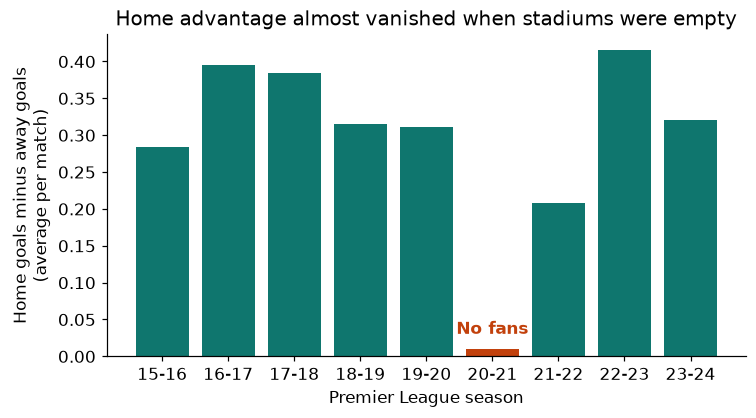

# Fun project: Is home advantage real?

Teams win more at home. But why? Is it the crowd, the travel, the familiar pitch? Normally you cannot separate these, because fans are always there. Then COVID-19 emptied the stadiums: for over a year, English Premier League matches were played with no crowds, while teams still traveled and still played on their own pitches. That is a **natural experiment**: it removes one cause and leaves the others.

!!! info "What you will practice"
    Downloading and stacking many files · parsing dates · group summaries · a natural experiment · fixed effects for team quality · testing a mechanism (referee bias)

    **Time:** about an hour. **Languages:** Stata, R or Python. Pick one in any tab and the whole page follows.



## The data

[football-data.co.uk](https://www.football-data.co.uk/englandm.php) publishes a free CSV file of every Premier League match for each season. You will use nine seasons, 2015–16 to 2023–24: 3,420 matches.

| Column | Meaning |
|---|---|
| `Date` | Match date |
| `HomeTeam`, `AwayTeam` | Team names |
| `FTHG`, `FTAG` | Full-time home goals, away goals |
| `FTR` | Result: `H` home win, `D` draw, `A` away win |
| `HY`, `AY` | Yellow cards for the home and away team |

**The experiment:** the 2019–20 season paused in March 2020 and restarted in June with no fans. The whole 2020–21 season was played behind closed doors, apart from a few matches with small crowds in December 2020 and May 2021. Treat June 2020 to May 2021 as the "no fans" period.

## Step 1: Download and stack nine seasons

Each season is a separate file. Loop over them, add a season label, and stack them into one table.

=== "Stata"

    ```stata
    clear
    tempfile all
    save `all', emptyok

    foreach s in 1516 1617 1718 1819 1920 2021 2122 2223 2324 {
        import delimited "https://www.football-data.co.uk/mmz4281/`s'/E0.csv", ///
            clear varnames(1) stringcols(2)
        keep date hometeam awayteam fthg ftag ftr hy ay
        gen season = "20" + substr("`s'", 1, 2) + "-" + substr("`s'", 3, 2)
        append using `all'
        save `all', replace
    }
    drop if missing(fthg)
    ```

=== "R"

    ```r
    library(tidyverse)
    library(fixest)

    seasons <- c("1516", "1617", "1718", "1819", "1920", "2021", "2122", "2223", "2324")

    read_season <- function(s) {
      read_csv(paste0("https://www.football-data.co.uk/mmz4281/", s, "/E0.csv"),
               col_select = c(Date, HomeTeam, AwayTeam, FTHG, FTAG, FTR, HY, AY),
               show_col_types = FALSE) %>%
        mutate(season = paste0("20", substr(s, 1, 2), "-", substr(s, 3, 4)))
    }

    games <- map(seasons, read_season) %>%
      list_rbind() %>%
      filter(!is.na(FTHG))
    ```

=== "Python"

    ```python
    import pandas as pd
    import pyfixest as pf

    seasons = ["1516", "1617", "1718", "1819", "1920", "2021", "2122", "2223", "2324"]
    frames = []
    for s in seasons:
        season = pd.read_csv(
            f"https://www.football-data.co.uk/mmz4281/{s}/E0.csv",
            usecols=["Date", "HomeTeam", "AwayTeam", "FTHG", "FTAG", "FTR", "HY", "AY"])
        season["season"] = f"20{s[:2]}-{s[2:]}"
        frames.append(season)

    games = pd.concat(frames, ignore_index=True).dropna(subset=["FTHG"])
    ```

**Check:** **3,420** matches (9 seasons × 380 matches).

## Step 2: Create the variables

Dates are written day first, and older seasons use two-digit years (`08/08/15`), so parse them carefully.

=== "Stata"

    ```stata
    gen match_date = date(date, "DMY")
    replace match_date = date(date, "DM20Y") if missing(match_date)   // two-digit years
    format match_date %td

    gen goal_diff = fthg - ftag                   // home goals minus away goals
    gen home_win  = (ftr == "H")
    gen no_fans   = inrange(match_date, td(01jun2020), td(31may2021))
    gen card_gap  = ay - hy                       // away yellows minus home yellows
    ```

=== "R"

    ```r
    games <- games %>%
      mutate(date      = dmy(Date),               # handles two- and four-digit years
             goal_diff = FTHG - FTAG,             # home goals minus away goals
             home_win  = as.integer(FTR == "H"),
             no_fans   = as.integer(date >= as.Date("2020-06-01") & date <= as.Date("2021-05-31")),
             card_gap  = AY - HY)                 # away yellows minus home yellows
    ```

=== "Python"

    ```python
    games["date"] = pd.to_datetime(games["Date"], dayfirst=True, format="mixed")
    games["goal_diff"] = games["FTHG"] - games["FTAG"]          # home minus away goals
    games["home_win"] = (games["FTR"] == "H").astype(int)
    games["no_fans"] = games["date"].between("2020-06-01", "2021-05-31").astype(int)
    games["card_gap"] = games["AY"] - games["HY"]                # away minus home yellows
    ```

**Check:** **472** matches were played without fans.

## Step 3: Compare matches with and without fans

=== "Stata"

    ```stata
    tabstat home_win goal_diff card_gap, by(no_fans)
    tabstat goal_diff, by(season)
    ```

=== "R"

    ```r
    games %>%
      summarise(home_win = mean(home_win), goal_diff = mean(goal_diff),
                card_gap = mean(card_gap), .by = no_fans)

    games %>% summarise(goal_diff = mean(goal_diff), .by = season)
    ```

=== "Python"

    ```python
    games.groupby("no_fans")[["home_win", "goal_diff", "card_gap"]].mean()
    games.groupby("season")["goal_diff"].mean()
    ```

**Check:**

| | With fans | Without fans |
|---|---:|---:|
| Home teams win | 45.8% | 39.6% |
| Home goal advantage (goals per match) | **0.33** | **0.08** |
| Extra yellow cards for the away team | **0.19** | **0.01** |

With crowds, home teams scored about a third of a goal more per match than away teams. Without crowds, three quarters of that advantage disappeared. In the 2020–21 season it was just 0.01 goals.

## Step 4: Is the drop statistically significant?

Regress the goal difference on the no-fans dummy. The constant is the home advantage with fans, and the `no_fans` coefficient is how much it changed.

Team quality could matter too: perhaps strong teams happened to play away more often in 2020–21. Adding **home-team and away-team fixed effects** compares the same teams with and without fans.

=== "Stata"

    ```stata
    regress goal_diff no_fans, vce(robust)

    * reghdfe needs: ssc install reghdfe, ssc install ftools, ssc install require
    encode hometeam, gen(home_id)
    encode awayteam, gen(away_id)
    reghdfe goal_diff no_fans, absorb(home_id away_id) vce(robust)
    ```

=== "R"

    ```r
    simple <- feols(goal_diff ~ no_fans, data = games, vcov = "hetero")
    teams  <- feols(goal_diff ~ no_fans | HomeTeam + AwayTeam, data = games, vcov = "hetero")
    etable(simple, teams)
    ```

=== "Python"

    ```python
    simple = pf.feols("goal_diff ~ no_fans", data=games, vcov="hetero")
    teams = pf.feols("goal_diff ~ no_fans | HomeTeam + AwayTeam", data=games, vcov="hetero")
    pf.etable([simple, teams])
    ```

**Check:**

| Model | Effect of no fans on home goal advantage |
|---|---:|
| Simple comparison | −0.25 (standard error 0.10) |
| With team fixed effects | −0.22 (standard error 0.09) |

Both are significant at the 5% level. Controlling for which teams played barely changes the answer.

## Step 5: Why? Testing a mechanism

If crowds create home advantage, **how**? One idea: referees, consciously or not, favor the team the crowd supports. If so, the away team's disadvantage in yellow cards should shrink without fans.

=== "Stata"

    ```stata
    regress card_gap no_fans, vce(robust)
    ```

=== "R"

    ```r
    feols(card_gap ~ no_fans, data = games, vcov = "hetero")
    ```

=== "Python"

    ```python
    pf.feols("card_gap ~ no_fans", data=games, vcov="hetero").summary()
    ```

**Check:** with fans, away teams got **0.19** more yellow cards per match than home teams. Without fans, the gap fell by **0.18** to almost zero (standard error 0.08). Referees treated the two teams almost identically when nobody was watching from the stands.

## What this shows, and what it does not

- **It supports** the idea that crowds cause much of home advantage, partly by influencing referees. Published studies of many European leagues during COVID find the same pattern.
- **It is not perfect.** The 2020–21 season differed in other ways too: a packed schedule, no pre-season, players under COVID rules. A careful paper would discuss these alternative explanations. Can you think of how to test one?
- **External validity:** this is one league over one unusual year. Would it hold in basketball, where crowds are closer to the court?

## Go further

1. **Other leagues.** Swap `E0` in the address for `SP1` (Spain), `D1` (Germany), `I1` (Italy) or `F1` (France). Is the pattern the same?
2. **Fouls.** Repeat Step 5 with fouls (`HF` and `AF`). Do fouls follow the same pattern as cards?
3. **Betting markets.** The files include bookmaker odds (`B365H`, `B365A`). How quickly did betting markets adjust to the loss of home advantage?
4. **Difference-in-differences.** Compare leagues by when crowds returned. See the [DiD page](../econometrics/did.md).
