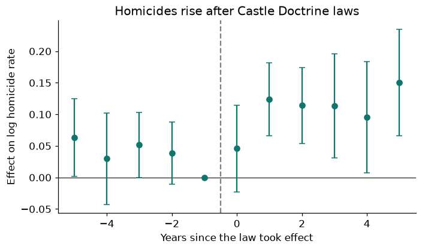

# Replication: Do "stand your ground" laws increase homicides?

Between 2005 and 2009, 21 US states passed **Castle Doctrine** laws. These laws widened the right to use deadly force in self-defense, including "stand your ground" provisions that removed the duty to retreat. Supporters argued they would deter crime. Critics argued they would escalate violence. In this project you reproduce the main result of **Cheng and Hoekstra (2013), "Does Strengthening Self-Defense Law Deter Crime or Escalate Violence?"**, *Journal of Human Resources* 48(3), with [difference-in-differences](../econometrics/did.md).

!!! info "What you will practice"
    A staggered difference-in-differences design · two-way fixed effects with population weights · region-by-year fixed effects · reading an event study critically · the Callaway and Sant'Anna estimator · comparing estimators

    **Time:** about 90 minutes. **Languages:** Stata, R or Python. **Before you start:** read the [difference-in-differences page](../econometrics/did.md), especially Part 3.

## The design

Florida passed its law in 2005. Thirteen states followed in 2006, four in 2007, two in 2008 and one in 2009. Twenty-nine states never passed one during this period. Because states adopt at **different times**, this is a staggered DiD: each adopting state is compared with states that had not (yet) adopted.

| Piece | In this study |
|---|---|
| Units | 50 US states |
| Periods | 2000 to 2010 (550 state-years) |
| Treatment | Castle Doctrine law in effect (`post`) |
| Adoption year | `effyear`, missing for states that never adopted |
| Outcome | Log homicides per 100,000 people (`l_homicide`) |
| Weights | State population (`popwt`), so large states count more |

The data come with Scott Cunningham's [Causal Inference: The Mixtape](https://mixtape.scunning.com/09-difference_in_differences).

## Step 1: Load the data

=== "Stata"

    ```stata
    use "https://github.com/scunning1975/mixtape/raw/master/castle.dta", clear
    gen region = 1*northeast + 2*midwest + 3*south + 4*west
    tabulate effyear, missing             // how many states adopted each year
    ```

=== "R"

    ```r
    library(tidyverse)
    library(haven)
    library(fixest)
    library(did)

    castle <- read_dta("https://github.com/scunning1975/mixtape/raw/master/castle.dta") %>%
      mutate(region = case_when(northeast == 1 ~ "Northeast", midwest == 1 ~ "Midwest",
                                south == 1 ~ "South", west == 1 ~ "West"))

    castle %>% distinct(sid, effyear) %>% count(effyear)
    ```

=== "Python"

    ```python
    # pip install pyfixest csdid
    import numpy as np
    import pandas as pd
    import pyfixest as pf

    castle = pd.read_stata("https://github.com/scunning1975/mixtape/raw/master/castle.dta")
    castle["region"] = np.select(
        [castle["northeast"] == 1, castle["midwest"] == 1, castle["south"] == 1, castle["west"] == 1],
        ["Northeast", "Midwest", "South", "West"], "")

    castle.groupby("effyear", dropna=False)["sid"].nunique()
    ```

**Check:** 1 state adopted in 2005, 13 in 2006, 4 in 2007, 2 in 2008, 1 in 2009, and 29 never adopted.

## Step 2: Two-way fixed effects

The classic approach: state fixed effects remove permanent differences between states, and year fixed effects remove shocks that hit every state at once.

=== "Stata"

    ```stata
    * reghdfe needs: ssc install reghdfe, ssc install ftools, ssc install require
    reghdfe l_homicide post [aweight = popwt], absorb(sid year) vce(cluster sid)
    ```

=== "R"

    ```r
    twfe <- feols(l_homicide ~ post | sid + year,
                  data = castle, weights = ~popwt, cluster = ~sid)
    ```

=== "Python"

    ```python
    twfe = pf.feols("l_homicide ~ post | sid + year",
                    data=castle, weights="popwt", vcov={"CRV1": "sid"})
    twfe.summary()
    ```

**Check:** the coefficient on `post` is **0.076** (standard error 0.033).

## Step 3: Region-by-year fixed effects

Crime trends differ across regions: the South may follow a different path from the Northeast. Replacing year effects with **region-by-year** effects compares each adopting state only with states in the same region in the same year.

=== "Stata"

    ```stata
    reghdfe l_homicide post [aweight = popwt], absorb(sid region#year) vce(cluster sid)
    ```

=== "R"

    ```r
    region_year <- feols(l_homicide ~ post | sid + region^year,
                         data = castle, weights = ~popwt, cluster = ~sid)
    etable(twfe, region_year)
    ```

=== "Python"

    ```python
    region_year = pf.feols("l_homicide ~ post | sid + year^region",
                           data=castle, weights="popwt", vcov={"CRV1": "sid"})
    pf.etable([twfe, region_year])
    ```

**Check:** **0.086** (standard error 0.026).

Because the outcome is in logs, Castle Doctrine laws raised homicides by about **8%**. This matches Cheng and Hoekstra's headline result. They estimate it means roughly 600 additional homicides per year across the adopting states.

## Step 4: Event study

Estimate a separate effect for each year before and after adoption. Before adoption, the effects should be near zero. States that never adopted are placed in the base category (year −1), so they serve as the comparison.

=== "Stata"

    ```stata
    gen rel = cond(missing(effyear), -1, year - effyear)
    gen rel_f = rel + 10                  // factor variables must be 0 or more; base -1 becomes 9
    reghdfe l_homicide ib9.rel_f [aweight = popwt], absorb(sid year) vce(cluster sid)
    ```

=== "R"

    ```r
    castle <- castle %>% mutate(rel = ifelse(is.na(effyear), -1, year - effyear))

    es <- feols(l_homicide ~ i(rel, ref = -1) | sid + year,
                data = castle, weights = ~popwt, cluster = ~sid)
    iplot(es)
    ```

=== "Python"

    ```python
    castle["rel"] = np.where(castle["effyear"].isna(), -1,
                             castle["year"] - castle["effyear"]).astype(int)

    es = pf.feols("l_homicide ~ i(rel, ref=-1) | sid + year",
                  data=castle, weights="popwt", vcov={"CRV1": "sid"})
    es.iplot()
    ```



The chart shows years −5 to +5. Earlier years rely on Florida alone and are very noisy.

**Read it critically.** After adoption, homicides rise by about 10–15% and stay higher. Before adoption, the estimates are small but mostly **positive** (0.03 to 0.06), and one is borderline significant. That could mean adopting states were already on a slightly rising path, so part of the post-adoption increase may not be caused by the law. The jump at year 1 is much larger than any pre-period movement, which supports a real effect. But a careful researcher reports this pattern rather than hiding it. Cheng and Hoekstra address it with region-by-year effects and state-specific trends.

## Step 5: Callaway and Sant'Anna

With staggered adoption, two-way fixed effects can compare newly adopting states with states that adopted **earlier**. Callaway and Sant'Anna's estimator avoids this by comparing each group only with states that have not adopted yet. See [Part 3 of the DiD page](../econometrics/did.md#part-3-staggered-timing-and-why-twfe-can-mislead).

=== "Stata"

    ```stata
    gen gvar = cond(missing(effyear), 0, effyear)     // 0 = never treated
    csdid l_homicide, ivar(sid) time(year) gvar(gvar) rseed(1)
    estat simple
    estat event
    ```

=== "R"

    ```r
    castle <- castle %>% mutate(gvar = ifelse(is.na(effyear), 0, effyear))   # 0 = never treated

    cs <- att_gt(yname = "l_homicide", tname = "year", idname = "sid",
                 gname = "gvar", data = castle)
    aggte(cs, type = "simple")
    ggdid(aggte(cs, type = "dynamic"))
    ```

=== "Python"

    ```python
    from csdid.att_gt import ATTgt

    castle["gvar"] = castle["effyear"].fillna(0).astype(int)   # 0 = never treated

    cs = ATTgt(yname="l_homicide", gname="gvar", idname="sid",
               tname="year", data=castle).fit(est_method="dr")
    cs.aggte(typec="simple")
    cs.aggte(typec="dynamic")
    ```

**Check:** the overall effect is about **0.11** (standard error about 0.04). R may warn that some adoption groups are small: the 2005 and 2009 groups have one state each. This estimator is unweighted, so each state counts equally.

## Compare the estimates

| Estimator | Effect on log homicides |
|---|---:|
| Two-way fixed effects | 0.076 |
| Region-by-year fixed effects | 0.086 |
| Callaway and Sant'Anna | 0.110 |

Every method finds that homicides **rose**, by roughly 8 to 11 percent. There is no sign of the deterrent effect supporters predicted. When several reasonable estimators agree, the finding is more believable.

## What you learned

- [x] How staggered adoption works, and why the comparison group matters
- [x] Two-way and region-by-year fixed effects, with population weights and clustered errors
- [x] How to read an event study, including imperfect pre-trends
- [x] How a modern estimator compares with two-way fixed effects

## Go further

1. **Other crimes.** Swap `l_homicide` for `l_robbery`, `l_burglary` or `l_assault`. Do the laws deter any crime? Cheng and Hoekstra find no deterrence.
2. **Unweighted.** Drop the population weights from Step 2. How much does the estimate change?
3. **Not-yet-treated controls.** In `att_gt()`, add `control_group = "notyettreated"`. In Stata, add the `notyet` option to `csdid`.
4. **Read the paper.** Compare your table with Cheng and Hoekstra's main results tables. What do they add that you did not?
