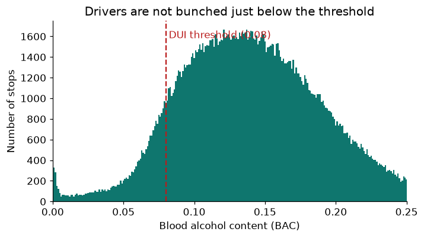
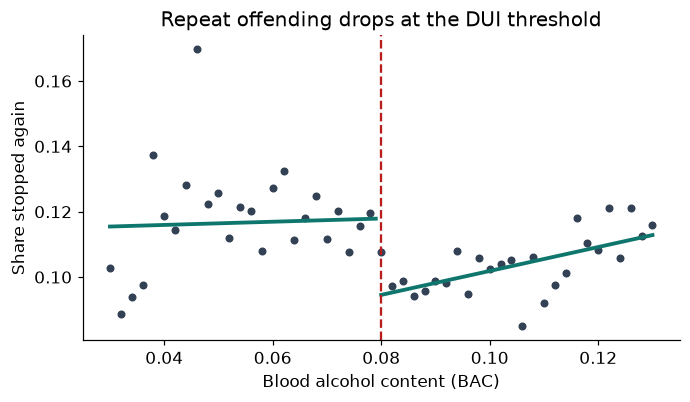

# Replication: Do harsher punishments deter drunk driving?

Replicating a published paper is the best way to learn how real research works. In this project you reproduce the main result of **Hansen (2015), "Punishment and Deterrence: Evidence from Drunk Driving"**, *American Economic Review* 105(4), using a [regression discontinuity](../econometrics/rd.md) design.

!!! info "What you will practice"
    Reading a research design · checking for manipulation · testing covariate balance · estimating an RD by hand and with `rdrobust` · robustness checks · a real data trap: floating-point numbers

    **Time:** about 90 minutes. **Languages:** Stata, R or Python. **Before you start:** read the [regression discontinuity page](../econometrics/rd.md).

## The question and the design

Does a harsher punishment make people less likely to drive drunk again? Comparing people who got harsh and mild punishments does not answer this: they differ in how much they drank, their history and more.

Hansen uses a rule. In Washington State, a driver whose **blood alcohol content (BAC)** is **0.08 or higher** is charged with DUI, with larger fines, license suspension and possible jail. A driver at 0.079 faces much less. Drivers at 0.079 and 0.081 are nearly identical, and a breath test is hard to control to a thousandth of a point. So comparing drivers **just above and just below 0.08** isolates the effect of the harsher punishment.

| Piece | In this study |
|---|---|
| Running variable | BAC, measured by breath test (`bac1`) |
| Cutoff | 0.08 |
| Treatment | Being charged with DUI (`dui = 1` if BAC ≥ 0.08) |
| Outcome | Caught drunk driving again later (`recidivism`) |

The data have 214,558 traffic stops in Washington State from 1999 to 2007. They are distributed with Scott Cunningham's [Causal Inference: The Mixtape](https://mixtape.scunning.com/06-regression_discontinuity).

## Step 1: Load the data

=== "Stata"

    ```stata
    use "https://github.com/scunning1975/mixtape/raw/master/hansen_dwi.dta", clear

    gen double bac = round(bac1, 0.001)     // see the note below
    gen dui   = (bac >= 0.08)
    gen bac_c = bac - 0.08                  // distance from the cutoff
    ```

=== "R"

    ```r
    library(tidyverse)
    library(haven)
    library(fixest)
    library(rdrobust)
    library(rddensity)       # install.packages(c("rdrobust", "rddensity"))

    df <- read_dta("https://github.com/scunning1975/mixtape/raw/master/hansen_dwi.dta") %>%
      mutate(bac   = round(as.numeric(bac1), 3),     # see the note below
             dui   = as.integer(bac >= 0.08),
             bac_c = bac - 0.08)                     # distance from the cutoff
    ```

=== "Python"

    ```python
    # pip install rdrobust pyfixest
    import pandas as pd
    import pyfixest as pf
    from rdrobust import rdrobust

    df = pd.read_stata("https://github.com/scunning1975/mixtape/raw/master/hansen_dwi.dta")
    df["bac"] = df["bac1"].astype("float64").round(3)   # see the note below
    df["dui"] = (df["bac"] >= 0.08).astype(int)
    df["bac_c"] = df["bac"] - 0.08                       # distance from the cutoff
    ```

!!! warning "A real data trap: floating-point numbers"
    `bac1` is stored in single precision, so a value printed as 0.13 is actually 0.12999999523. Without rounding, `bac <= 0.13` includes or drops those drivers depending on the language, and Stata, R and Python give slightly different samples. Rounding to three decimals, the precision of the breath test, makes every language agree. Watch for this whenever you compare decimals to a cutoff.

## Step 2: Check for manipulation

If drivers or police could push readings to just below 0.08, the people on each side would differ, and the design would fail. Look for a pile-up of stops just below the cutoff.



=== "Stata"

    ```stata
    histogram bac, width(0.001) xline(0.08)
    rddensity bac, c(0.08)                  // formal test; see the RD page to install
    ```

=== "R"

    ```r
    ggplot(df, aes(bac)) +
      geom_histogram(binwidth = 0.001) +
      geom_vline(xintercept = 0.08, linetype = "dashed")

    summary(rddensity(X = df$bac, c = 0.08))
    ```

=== "Python"

    ```python
    counts = df["bac"].value_counts().sort_index()
    counts.loc[0.07:0.09]       # stops at each BAC value around the cutoff
    ```

**Check:** the histogram is smooth through 0.08. There were 973 stops at 0.079 and 909 at 0.080, with no spike just below. The formal density test has a p-value of about 0.79. No sign of manipulation.

## Step 3: Check covariate balance

Characteristics decided **before** the stop should not jump at 0.08. Hansen checks sex, race, age and whether there was an accident. Use drivers with BAC from 0.03 to 0.13 (a bandwidth of 0.05) and a separate line on each side of the cutoff.

=== "Stata"

    ```stata
    foreach v of varlist male white aged acc {
        regress `v' i.dui##c.bac_c if inrange(bac, 0.03, 0.13), vce(robust)
    }
    ```

=== "R"

    ```r
    window <- filter(df, between(bac, 0.03, 0.13))
    balance <- feols(c(male, white, aged, acc) ~ dui * bac_c, data = window, vcov = "hetero")
    etable(balance, keep = "^dui$")
    ```

=== "Python"

    ```python
    window = df[df["bac"].between(0.03, 0.13)]
    for v in ["male", "white", "aged", "acc"]:
        m = pf.feols(f"{v} ~ dui * bac_c", data=window, vcov="hetero")
        print(v, round(m.coef()["dui"], 4), "p =", round(m.pvalue()["dui"], 3))
    ```

`dui * bac_c` lets the slope differ on each side of the cutoff. The `dui` coefficient is the jump at 0.08.

**Check:** none of the four jumps is significant (all p-values above 0.3). The window has **90,074** drivers.

## Step 4: The main result

=== "Stata"

    ```stata
    regress recidivism i.dui##c.bac_c male white aged acc if inrange(bac, 0.03, 0.13), vce(robust)
    ```

=== "R"

    ```r
    feols(recidivism ~ dui * bac_c + male + white + aged + acc,
          data = window, vcov = "hetero")
    ```

=== "Python"

    ```python
    main = pf.feols("recidivism ~ dui * bac_c + male + white + aged + acc",
                    data=window, vcov="hetero")
    main.summary()
    ```

**Check:** the DUI coefficient is **−0.0237** (standard error 0.0045).

Just below the threshold, 11.7% of drivers are caught drunk driving again. Crossing 0.08 lowers that by about **2.4 percentage points**, roughly a **20% drop**. Hansen reports an effect of about 2 percentage points. You have replicated the paper's main finding.



## Step 5: The modern estimator

`rdrobust` chooses the bandwidth from the data and reports bias-corrected confidence intervals.

=== "Stata"

    ```stata
    rdrobust recidivism bac, c(0.08)
    ```

=== "R"

    ```r
    summary(rdrobust(y = df$recidivism, x = df$bac, c = 0.08))
    ```

=== "Python"

    ```python
    print(rdrobust(y=df["recidivism"], x=df["bac"], c=0.08))
    ```

**Check:** the estimate is about **−0.016**, with a robust 95% confidence interval that excludes zero. `rdrobust` picks a narrower bandwidth (about 0.03), so the estimate is less precise but tells the same story. A warning about "mass points" is expected, because BAC takes only a few hundred distinct values.

## Step 6: Robustness

A credible result should not hinge on one choice. Try:

| Check | Change | Result |
|---|---|---:|
| Main specification | Bandwidth 0.05, linear, controls | −0.024 |
| Narrower bandwidth | `inrange(bac, 0.055, 0.105)` | −0.018 |
| Quadratic on each side | Add `bac_c` squared, interacted with `dui` | −0.012 |
| `rdrobust` | Data-driven bandwidth, bias-corrected | −0.016 |

All estimates are negative. They shrink somewhat with narrower windows and more flexible fits, which is common: those choices use fewer drivers and are noisier. Report this kind of table in your own work.

## What you learned

- [x] How an RD design turns a legal rule into a natural experiment
- [x] The checks that make RD credible: no manipulation, balanced covariates
- [x] Estimating a jump with separate slopes on each side of a cutoff
- [x] Why results should be checked across bandwidths and functional forms
- [x] How floating-point precision can quietly change your sample

## Go further

1. **The aggravated threshold.** Washington imposes even harsher penalties at **0.15**. Repeat the analysis at that cutoff. Hansen finds a further deterrent effect.
2. **Read the paper.** Compare your estimates with Hansen's main results tables and figures. What does he do differently?
3. **More replications.** The [Mixtape data repository](https://github.com/scunning1975/mixtape) has datasets for many famous papers, including the Castle Doctrine study (difference-in-differences) and the NSW job-training experiment (matching).
