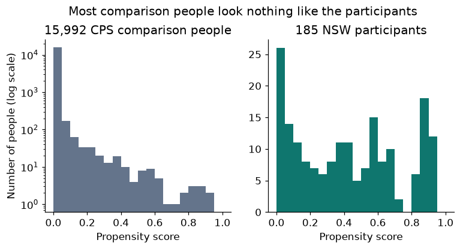

# Replication: Can we recover an experiment without one?

In the 1970s, the **National Supported Work (NSW)** program offered disadvantaged workers a job for up to 18 months. Crucially, places were assigned by **lottery**, so the program's true effect on earnings is known. In a famous 1986 paper, Robert LaLonde asked: if we had no experiment, and compared participants with ordinary survey respondents, would standard methods get the right answer? Dehejia and Wahba (1999, 2002) then asked whether [propensity score methods](../econometrics/matching.md) could do better.

This project reproduces that debate. You will see a naive comparison get the sign wrong, regression get halfway there, and weighting and matching get close, but only after dealing with **overlap**.

!!! info "What you will practice"
    Using an experiment as a benchmark · selection bias · regression with controls · estimating propensity scores · checking overlap · inverse probability weighting · nearest-neighbor matching · judging how fragile an estimate is

    **Time:** about 90 minutes. **Languages:** Stata, R or Python. **Before you start:** read the [matching and propensity scores page](../econometrics/matching.md).

## The data

Both files come with Scott Cunningham's [Causal Inference: The Mixtape](https://mixtape.scunning.com/05-causal_cross_sectional_designs).

| File | Who | Rows |
|---|---|---:|
| `nsw_mixtape.dta` | NSW experiment: 185 participants (`treat = 1`) and 260 randomized-out controls (`treat = 0`) | 445 |
| `cps_mixtape.dta` | Current Population Survey respondents, used as a non-experimental comparison group | 15,992 |

| Variable | Meaning |
|---|---|
| `re74`, `re75`, `re78` | Earnings in 1974, 1975 and 1978 (1978 is the outcome) |
| `age`, `educ` | Age and years of schooling |
| `black`, `hisp`, `marr`, `nodegree` | Race, ethnicity, married, no high school diploma |

## Step 1: The experimental benchmark

Because places were assigned at random, a simple difference in means is the causal effect.

=== "Stata"

    ```stata
    use "https://github.com/scunning1975/mixtape/raw/master/nsw_mixtape.dta", clear
    regress re78 treat, vce(robust)
    ```

=== "R"

    ```r
    library(tidyverse)
    library(haven)
    library(fixest)
    library(MatchIt)

    base <- "https://github.com/scunning1975/mixtape/raw/master/"
    nsw  <- read_dta(paste0(base, "nsw_mixtape.dta")) %>% zap_labels()
    cps  <- read_dta(paste0(base, "cps_mixtape.dta")) %>% zap_labels()

    feols(re78 ~ treat, data = nsw, vcov = "hetero")
    ```

=== "Python"

    ```python
    import numpy as np
    import pandas as pd
    import pyfixest as pf
    import statsmodels.formula.api as smf

    base = "https://github.com/scunning1975/mixtape/raw/master/"
    nsw = pd.read_stata(base + "nsw_mixtape.dta")
    cps = pd.read_stata(base + "cps_mixtape.dta")

    pf.feols("re78 ~ treat", data=nsw, vcov="hetero").summary()
    ```

**Check:** **$1,794** (standard error $671). The program raised 1978 earnings by about $1,800. This is the answer every other method should try to match.

## Step 2: Throw away the experiment

Now pretend there was no lottery. Keep the 185 participants, drop the randomized controls, and use the 15,992 CPS respondents as the comparison group. Add the variables the propensity score will need.

=== "Stata"

    ```stata
    keep if treat == 1
    append using "https://github.com/scunning1975/mixtape/raw/master/cps_mixtape.dta"

    gen age2 = age^2
    gen age3 = age^3
    gen educ2 = educ^2
    gen u74 = (re74 == 0)                 // unemployed in 1974
    gen u75 = (re75 == 0)
    gen educ_re74 = educ * re74

    tabstat age educ black marr re75 re78, by(treat)
    ```

=== "R"

    ```r
    obs <- bind_rows(filter(nsw, treat == 1), cps) %>%
      mutate(age2 = age^2, age3 = age^3, educ2 = educ^2,
             u74 = as.integer(re74 == 0),          # unemployed in 1974
             u75 = as.integer(re75 == 0),
             educ_re74 = educ * re74)

    obs %>% summarise(across(c(age, educ, black, marr, re75, re78), mean), .by = treat)
    ```

=== "Python"

    ```python
    obs = pd.concat([nsw[nsw["treat"] == 1], cps], ignore_index=True)
    obs["age2"] = obs["age"] ** 2
    obs["age3"] = obs["age"] ** 3
    obs["educ2"] = obs["educ"] ** 2
    obs["u74"] = (obs["re74"] == 0).astype(int)      # unemployed in 1974
    obs["u75"] = (obs["re75"] == 0).astype(int)
    obs["educ_re74"] = obs["educ"] * obs["re74"]

    obs.groupby("treat")[["age", "educ", "black", "marr", "re75", "re78"]].mean()
    ```

**Check:** 16,177 people. The groups are very different. Participants average 26 years old and 84% are Black; CPS respondents average 33 and 7% are Black. CPS respondents earned about $13,700 in 1975, against $1,500 for participants.

## Step 3: Naive comparison and regression

=== "Stata"

    ```stata
    regress re78 treat, vce(robust)
    regress re78 treat age age2 educ black hisp marr nodegree re74 re75 u74 u75, vce(robust)
    ```

=== "R"

    ```r
    feols(re78 ~ treat, data = obs, vcov = "hetero")
    feols(re78 ~ treat + age + age2 + educ + black + hisp + marr + nodegree +
            re74 + re75 + u74 + u75, data = obs, vcov = "hetero")
    ```

=== "Python"

    ```python
    controls = "age + age2 + educ + black + hisp + marr + nodegree + re74 + re75 + u74 + u75"
    pf.feols("re78 ~ treat", data=obs, vcov="hetero").summary()
    pf.feols(f"re78 ~ treat + {controls}", data=obs, vcov="hetero").summary()
    ```

**Check:** the naive difference is **−$8,498**: the program appears to **cut** earnings by $8,500. That is pure selection bias, because the CPS group was far better off to begin with. Regression with controls gives **$1,137**: right sign, but well below $1,794.

## Step 4: Estimate the propensity score and check overlap

The propensity score is each person's predicted probability of being in the program. The specification follows Dehejia and Wahba.

=== "Stata"

    ```stata
    local x "age age2 age3 educ educ2 marr nodegree black hisp re74 re75 u74 u75 educ_re74"
    logit treat `x'
    predict pscore

    * Common support: keep people whose score is within the participants' range
    summarize pscore if treat == 1
    gen common = inrange(pscore, r(min), r(max))
    tab common treat
    ```

=== "R"

    ```r
    ps_formula <- treat ~ age + age2 + age3 + educ + educ2 + marr + nodegree +
      black + hisp + re74 + re75 + u74 + u75 + educ_re74
    obs$pscore <- predict(glm(ps_formula, data = obs, family = binomial), type = "response")

    # Common support: keep people whose score is within the participants' range
    range_t <- range(obs$pscore[obs$treat == 1])
    common  <- filter(obs, between(pscore, range_t[1], range_t[2]))
    count(common, treat)
    ```

=== "Python"

    ```python
    ps_formula = ("treat ~ age + age2 + age3 + educ + educ2 + marr + nodegree"
                  " + black + hisp + re74 + re75 + u74 + u75 + educ_re74")
    obs["pscore"] = smf.logit(ps_formula, data=obs).fit().predict(obs)

    # Common support: keep people whose score is within the participants' range
    lo, hi = obs.loc[obs["treat"] == 1, "pscore"].agg(["min", "max"])
    common = obs[obs["pscore"].between(lo, hi)].copy()
    common["treat"].value_counts()
    ```



Over 90% of CPS respondents have a propensity score below 0.01: they look nothing like program participants. Comparing participants with them is meaningless. Restricting to **common support** keeps all 185 participants and **3,856** of the 15,992 comparison people.

!!! note "When software refuses"
    Stata's `teffects ipw` on the full sample stops with "treatment model has 3 observations completely determined". Some people's treatment status is perfectly predicted, which is an overlap failure. Restricting to common support first, as here, is the standard fix.

## Step 5: Inverse probability weighting

Give each comparison person a weight of \(p/(1-p)\), where \(p\) is their propensity score. People who look like participants count a lot. People who do not count almost nothing.

=== "Stata"

    ```stata
    gen w = cond(treat == 1, 1, pscore / (1 - pscore))
    regress re78 treat [pweight = w] if common, vce(robust)
    ```

=== "R"

    ```r
    common <- common %>% mutate(w = ifelse(treat == 1, 1, pscore / (1 - pscore)))
    feols(re78 ~ treat, data = common, weights = ~w, vcov = "hetero")
    ```

=== "Python"

    ```python
    common["w"] = np.where(common["treat"] == 1, 1, common["pscore"] / (1 - common["pscore"]))
    pf.feols("re78 ~ treat", data=common, weights="w", vcov="hetero").summary()
    ```

**Check:** **$1,860** (standard error $773). Within $70 of the experiment.

## Step 6: Nearest-neighbor matching

Match each participant with the five comparison people with the closest propensity scores, re-estimated on the common-support sample.

=== "Stata"

    ```stata
    teffects psmatch (re78) (treat `x', logit) if common, atet nneighbor(5)
    ```

=== "R"

    ```r
    m <- matchit(ps_formula, data = common, method = "nearest", distance = "glm",
                 replace = TRUE, ratio = 5, estimand = "ATT")
    feols(re78 ~ treat, data = match.data(m), weights = ~weights, vcov = "hetero")
    ```

=== "Python"

    ```python
    common["pscore_cs"] = smf.logit(ps_formula, data=common).fit().predict(common)
    treated = common[common["treat"] == 1]
    control = common[common["treat"] == 0]

    distance = np.abs(treated["pscore_cs"].to_numpy()[:, None]
                      - control["pscore_cs"].to_numpy()[None, :])
    nearest5 = np.argsort(distance, axis=1, kind="stable")[:, :5]
    matched_outcome = control["re78"].to_numpy()[nearest5].mean(axis=1)
    (treated["re78"].to_numpy() - matched_outcome).mean()
    ```

**Check:** about **$1,540 to $1,580**, depending on the software. With one neighbor instead of five, estimates range from about $1,650 to $1,800, because results with few matches depend on how ties are broken.

## Compare everything

| Method | Estimate | Gap from experiment |
|---|---:|---:|
| **Experiment (the truth)** | **$1,794** | — |
| Naive comparison with CPS | −$8,498 | −$10,292 |
| Regression with controls | $1,137 | −$657 |
| Inverse probability weighting, common support | $1,860 | +$66 |
| Matching, 5 neighbors, common support | about $1,560 | about −$230 |

## What this teaches

- **Selection bias can be enormous.** The naive comparison is not just off: it has the wrong sign.
- **Overlap matters most.** Propensity score methods worked here only after discarding the many comparison people who looked nothing like participants. Always plot the scores.
- **Estimates are fragile.** Different reasonable choices (how many neighbors, which software) move the answer by hundreds of dollars. Report several.
- **Experiments are the gold standard.** Dehejia and Wahba showed propensity scores *can* recover the truth here. Later work by Smith and Todd (2005) showed how sensitive that success is to the sample and specification. Without the experiment, you would not know which estimate to trust.

## Go further

1. **Drop the interaction.** Remove `educ_re74` and the cubed age from the propensity score. How much do the estimates move?
2. **Trim harder.** Keep only people with scores between 0.1 and 0.9. What happens to the sample size and the estimate?
3. **Doubly robust.** In Stata, run `teffects aipw (re78 `x') (treat `x', logit) if common, atet`.
4. **Balance table.** After matching, compare the means of each variable for participants and matched comparisons, as on the [matching page](../econometrics/matching.md#read-the-output).
